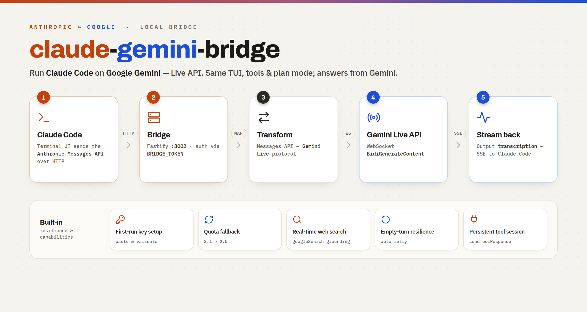

# claude-gemini-bridge

**Languages:** English (this file) · [Türkçe](./README.tr.md)



A local bridge that lets you run the **Claude Code CLI** with **Google Gemini** (Live API) as the backend model instead of Anthropic. Claude Code's terminal UI, tool system, and plan mode stay exactly the same — the responses are generated by Gemini.

> ⚠️ **Unofficial project.** Not affiliated with, endorsed by, or sponsored by Anthropic or Google. "Claude", "Claude Code", and "Gemini" are trademarks of their respective owners. This is an independent interoperability tool — use it in accordance with the terms of service of both Claude Code and the Gemini API.

## 🚀 Quick start

One command installs Claude Code and the bridge — needs **Node.js ≥ 20** (Linux, macOS, WSL, Windows PowerShell):

```bash
npm install -g @anthropic-ai/claude-code https://github.com/SerkanGezici/claude-gemini-bridge/releases/latest/download/claude-gemini-bridge.tgz
```

Then run it in any project — it prompts for your Gemini API key on first launch:

```bash
cd /path/to/your/project && claude-gemini
```

Optional, for reliable PDF / Word / Excel / image editing (needs Python 3): `claude-gemini --setup-docs`.

More options (SSH, dev setup, all config) are in [Install](#install) and [First run](#first-run-api-key) below.

### What a session looks like

```console
$ claude-gemini

╔══════════════════════════════════════════╗
║           claude-gemini-bridge           ║
║     Claude Code → Gemini Live API        ║
╚══════════════════════════════════════════╝
Bridge logs: ~/claude-gemini-bridge/logs/bridge.log
[info] Bridge ready at http://127.0.0.1:8002
[info] Launching Claude Code...

# Claude Code's normal TUI then opens — every prompt is answered by Gemini.
```

<!-- TODO(RELEASE-8): a recorded asciinema/GIF of a live session can be dropped in here. -->

## Why?

Claude Code has one of the best agentic CLI harnesses available (tool calls, plan mode, permissions, MCP). This bridge keeps that harness but swaps the model: every request Claude Code would send to Anthropic is translated and answered by Gemini over the Live API. Useful if you have Gemini API quota/keys and want to drive Claude Code's workflow with a Gemini model.

## Architecture

```
Claude Code (TUI) ──HTTP (Anthropic Messages API)──▶ Bridge (Fastify, :8002)
                                                        │ WebSocket (BidiGenerateContent)
                                                        ▼
                                          Gemini Live API
                                          (3.1 Flash Live — default;
                                           2.5 Flash Native Audio — quota fallback)
                                          AUDIO modality + output transcription
```

The bridge translates the Anthropic Messages API (what Claude Code speaks) into Gemini's Live `BidiGenerateContent` WebSocket protocol and streams the transcribed text back as Server-Sent Events.

## Requirements

- **Node.js ≥ 20**
- A **Gemini API key** — https://aistudio.google.com/apikey
- **Claude Code** installed (`npm install -g @anthropic-ai/claude-code`)

## Install

### Quick install

Install the latest prebuilt release straight from GitHub — no clone, no build step:

```bash
npm install -g https://github.com/SerkanGezici/claude-gemini-bridge/releases/latest/download/claude-gemini-bridge.tgz
```

This puts the `claude-gemini` command on your PATH as a self-contained install
(the tarball ships prebuilt `dist/`). Requires **Node.js ≥ 20**. Run the same command
again to update. A specific version: `npm install -g https://github.com/SerkanGezici/claude-gemini-bridge/releases/download/vX.Y.Z/claude-gemini-bridge.tgz`.

> **Why the release tarball and not `npm install -g github:…`?** Installing directly from
> a git URL runs an unreliable nested build/postinstall step (it can fail with
> `tsc: not found` or leave a broken symlink). The released tarball is prebuilt
> and self-contained, so it installs cleanly every time.

**Document tools (optional).** For PDF, Word, Excel and image editing the bridge manages a
pinned Python environment (openpyxl, python-docx, pypdf, PyMuPDF, Pillow). Create it once
with `claude-gemini --setup-docs` (needs Python 3; Ubuntu/Debian: `sudo apt install python3-venv`).

Then run it in any project directory — on first launch it asks for your Gemini
API key (see [First run](#first-run-api-key)):

```bash
cd /path/to/your/project && claude-gemini
```

### From source (for development)

```bash
git clone https://github.com/SerkanGezici/claude-gemini-bridge.git
cd claude-gemini-bridge
npm install          # dist/ is committed prebuilt; installs deps for dev
cp .env.example .env # then put your GEMINI_API_KEY in .env
npm start            # runs from src via tsx
```

### First run (API key)

You don't have to edit any file by hand. The first time you run `claude-gemini`
in a terminal, it checks your Gemini API key and, **if it's missing or invalid/
expired**, prompts you to paste one:

```console
$ claude-gemini
🔑 No Gemini API key found.
   Get a key: https://aistudio.google.com/apikey

Paste your Gemini API key: AIzaSy...
   validating... ✓ valid.
   Saved → ~/.config/claude-gemini-bridge/.env
```

The key is validated against the API, then saved to
`~/.config/claude-gemini-bridge/.env` (mode `600`) and the bridge continues
starting. On every later launch the key is re-validated, so a **revoked or
deactivated** key is caught immediately and you get a chance to fix it. This
runs only in an interactive terminal; set `SKIP_KEY_CHECK=1` to skip it, and in
non-interactive/CI runs it is a no-op.

## Usage

```bash
# Bridge + Claude Code together (most common)
npm start
# or, after a global install / build:
claude-gemini

# Bridge only (connect your own client via ANTHROPIC_BASE_URL + token)
npm run bridge
# or:
claude-gemini --bridge-only

# Run Claude Code in any project directory:
cd /path/to/your/project && claude-gemini
```

**Document editing (Excel / Word / PowerPoint / PDF / images):** run `claude-gemini --setup-docs` once (~30 s, ~350 MB).
It creates a pinned Python environment under `~/.local/share/claude-gemini-bridge/docenv` and enables the `office` MCP
tools (`office_inspect` before an edit, `office_compare` after it) so edits keep formatting, currency formats, styles and
EXIF. Disable with `BRIDGE_OFFICE_MCP=off`.

## Configuration

All configuration is via environment variables (see [`.env.example`](./.env.example)):

| Variable | Default | Description |
|---|---|---|
| `GEMINI_API_KEY` | _(required)_ | Your Gemini API key |
| `GEMINI_MODEL` | `models/gemini-3.1-flash-live-preview` _(set in `.env.example`)_ | Live model — recommended for quality. `-latest` aliases exist only for **some** families (live probe 2026-07-03: `…native-audio-latest` works; the 3.1-live family has none) — startup model discovery validates your choice against `models.list` and fails fast with suggestions. If neither `.env` nor an env var is set, the built-in default is `models/gemini-2.5-flash-native-audio-preview-12-2025`. |
| `GEMINI_FALLBACK_MODEL` | `models/gemini-2.5-flash-native-audio-preview-12-2025` | Model used during a `1011`/TPM quota **cooldown of the primary model**; `none` to disable |
| `QUOTA_COOLDOWN_MS` | `60000` | How long to stay on the fallback model after a quota error |
| `GEMINI_SEARCH_MODEL` | `gemini-2.5-flash` | Plain (non-Live) model used for real-time web-search grounding (fast path, 2-4s). Free tier allows **~20 grounded searches/day** (measured 2026-07-06); switching REST models does **not** raise that budget |
| `GEMINI_SEARCH_LIVE_MODEL` | `models/gemini-2.5-flash-native-audio-preview-12-2025` | **Live-grounded fallback** when the REST search quota is exhausted (or REST hits a transient error): a one-shot googleSearch-only Live session answers instead. Its quota pool is separate and effectively unlimited (measured 2026-07-07: 21 searches/day, no wall; only TPM-bound) at the cost of +5-10s latency. `none` disables. Note: the 3.1-live family does **not** support grounding — pick a 2.5 audio model |
| `PORT` | `8002` | Bridge port — auto-increments to the next free port if busy (unless `PORT` is set explicitly) |
| `HOST` | `127.0.0.1` | Bind address — **only `127.0.0.1`/`localhost`/`::1` are accepted; public addresses are rejected** |
| `DEBUG` | `false` | Write per-request dumps under `logs/requests/` |
| `BRIDGE_TOKEN` | _(random)_ | Auth token; auto-generated each start if empty |
| `SKIP_KEY_CHECK` | _(unset)_ | Set to `1` to skip the interactive startup API-key validation |
| `BRIDGE_OFFICE_MCP` | `on` | `off` disables the document `office` MCP tools (needs `claude-gemini --setup-docs`) |

## Security

This bridge is a **local API proxy** that holds your Gemini key in memory and exposes an Anthropic-compatible HTTP endpoint. To keep your key and machine safe:

- **Localhost-only by design.** `HOST` only accepts `127.0.0.1`, `localhost`, or `::1`; the bridge **rejects** public addresses like `0.0.0.0` at startup, so it can't be exposed to the network by misconfiguration.
- **Do not leave `BRIDGE_TOKEN` empty in shared/multi-user environments** — set a strong token so only your client can connect.
- **Never commit your `.env`.** It is already in `.gitignore`; only `.env.example` (placeholders) is tracked.
- Found a vulnerability? See [SECURITY.md](./SECURITY.md) for responsible disclosure.

## Troubleshooting

| Symptom | Cause | Fix |
|---|---|---|
| `1011` / quota error in logs | Gemini TPM limit hit (3.1 preview has a tight ~65K TPM) | The bridge auto-falls back to `GEMINI_FALLBACK_MODEL` for `QUOTA_COOLDOWN_MS`; consider a paid tier or the 2.5 model (1M TPM) |
| `404`/`1008` / model not found | Model name doesn't exist for that API (e.g. a `-latest` alias in a family that has none, like 3.1-live) | Check the startup model-discovery output — invalid names fail fast with candidate suggestions; pick a name from `models.list` |
| Port `8002` already in use | Another bridge instance is running | The bridge auto-increments (8002→8003…); or stop the stale process |
| Empty / "Let me check" reply | Known native-audio model behavior on heavy tool turns | Prefer the `3.1-flash-live` model; the bridge retries empty turns automatically |
| `claude: command not found` | Claude Code not installed | `npm install -g @anthropic-ai/claude-code` |
| `Both claude.ai and ANTHROPIC_API_KEY set` warning | Claude Code sees both your claude.ai login and the bridge's API key | Expected — if the banner shows **"API Usage Billing"**, it's routing through the bridge (answers come from Gemini). If replies ever look like real Claude, run `claude /logout`. |

## How it works (design notes)

- **Persistent tool session:** during a tool call the WebSocket session stays open; the tool result is returned to the same session via `sendToolResponse`. Sessions are tracked in a `functionCall id → handle` registry, so parallel Claude Code requests don't clobber each other.
- **Payload budgets** (`src/transformer.ts`): system ~24k chars / turns 48KB / tool-result caps. Very large payloads can trigger Live API errors.
- **Empty-turn resilience:** if the model returns an empty turn, the bridge retries; if it persists, it closes the turn gracefully.
- **Real-time web search:** the bridge exposes a synthetic `web_search` tool, intercepts it, and answers via a Gemini REST `googleSearch` grounding sub-request — without breaking the Live session's function declarations.

## Development

```bash
npm run build       # compile TypeScript to dist/
npm run typecheck   # tsc --noEmit (source + tests)
npm test            # unit tests (no API key needed)
npm run test:e2e    # end-to-end runner (requires a key)
```

Project tracking lives in [`PLANS/ACTIVE_PLAN.md`](./PLANS/ACTIVE_PLAN.md).

## Contributing

Issues and PRs are welcome. Please run `npm run typecheck && npm test` before opening a PR.

## License

[MIT](./LICENSE) © Serkan Gezici
