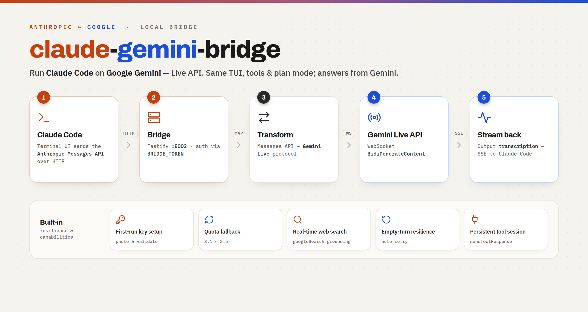

# claude-gemini-bridge

**Diller:** [English](./README.md) · Türkçe (bu dosya)



Claude Code CLI'ı, arkada Anthropic yerine **Google Gemini Live API** ile çalıştıran yerel köprü. Claude Code'un terminal arayüzü, araç sistemi ve plan modu aynen kalır; yanıtları Gemini üretir.

> ⚠️ **Gayriresmî proje.** Anthropic veya Google ile bağlantılı, onlar tarafından onaylanmış ya da desteklenmiş değildir. "Claude", "Claude Code" ve "Gemini" ilgili sahiplerinin ticari markalarıdır. Bağımsız bir birlikte-çalışabilirlik aracıdır — hem Claude Code'un hem de Gemini API'nin kullanım şartlarına uygun kullanın.

## 🚀 Hızlı başlangıç

Tek komut Claude Code'u ve köprüyü kurar — **Node.js ≥ 20** gerekir (Linux, macOS, WSL, Windows PowerShell):

```bash
npm install -g @anthropic-ai/claude-code https://github.com/SerkanGezici/claude-gemini-bridge/releases/latest/download/claude-gemini-bridge.tgz
```

Sonra herhangi bir projede çalıştır — ilk açılışta Gemini API anahtarını ister:

```bash
cd /proje/dizini && claude-gemini
```

İsteğe bağlı, PDF / Word / Excel / görsel düzenlemenin güvenilir çalışması için (Python 3 gerekir): `claude-gemini --setup-docs`.

Daha fazla seçenek (SSH, dev kurulumu, tüm ayarlar) aşağıdaki [Kurulum](#kurulum) bölümünde; ilk açılış detayı **İlk çalıştırma** bölümünde.

### Örnek oturum

```console
$ claude-gemini

╔══════════════════════════════════════════╗
║           claude-gemini-bridge           ║
║     Claude Code → Gemini Live API        ║
╚══════════════════════════════════════════╝
Bridge logs: ~/claude-gemini-bridge/logs/bridge.log
[info] Bridge ready at http://127.0.0.1:8002
[info] Launching Claude Code...

# Sonra Claude Code'un normal TUI'si açılır — her prompt Gemini tarafından yanıtlanır.
```

<!-- TODO(RELEASE-8): canlı oturumdan kaydedilmiş bir asciinema/GIF buraya konabilir. -->

## Neden?

Claude Code, mevcut en iyi agentic CLI ortamlarından birine sahip (tool çağrıları, plan modu, izinler, MCP). Bu köprü o ortamı korur ama modeli değiştirir: Claude Code'un Anthropic'e göndereceği her istek çevrilir ve Gemini tarafından Live API üzerinden yanıtlanır. Gemini API kotası/anahtarınız varsa ve Claude Code akışını bir Gemini modeliyle sürmek istiyorsanız işinize yarar.

## Mimari

```
Claude Code (TUI) ──HTTP (Anthropic Messages API)──▶ Bridge (Fastify, :8002)
                                                        │ WebSocket (BidiGenerateContent)
                                                        ▼
                                          Gemini Live API
                                          (3.1 Flash Live — varsayılan;
                                           2.5 Flash Native Audio — kota fallback)
                                          AUDIO modality + output transcription
```

Köprü, Anthropic Messages API'sini (Claude Code'un konuştuğu protokol) Gemini'nin Live `BidiGenerateContent` WebSocket protokolüne çevirir ve transkript edilmiş metni SSE ile geri akıtır.

## Gereksinimler

- **Node.js ≥ 20**
- Bir **Gemini API anahtarı** — https://aistudio.google.com/apikey
- Kurulu **Claude Code** (`npm install -g @anthropic-ai/claude-code`)

## Kurulum

### Hızlı kurulum

En güncel prebuilt sürümü doğrudan GitHub'dan kur — klonlamaya veya derlemeye gerek yok:

```bash
npm install -g https://github.com/SerkanGezici/claude-gemini-bridge/releases/latest/download/claude-gemini-bridge.tgz
```

`claude-gemini` komutunu PATH'ine kendi kendine yeten bir kurulum olarak ekler (tarball
prebuilt `dist/` içerir). **Node.js ≥ 20** gerekir. Güncellemek için aynı komutu yeniden
çalıştır. Belirli bir sürüm: `npm install -g https://github.com/SerkanGezici/claude-gemini-bridge/releases/download/vX.Y.Z/claude-gemini-bridge.tgz`.

> **Neden release tarball'ı, `npm install -g github:…` değil?** Doğrudan git URL'den kurulum,
> güvenilmez bir iç derleme/postinstall adımı çalıştırır (`tsc: not found` verebilir
> veya kırık symlink bırakır). Yayınlanan tarball prebuilt ve kendi kendine yeterlidir,
> her seferinde temiz kurulur.

**Belge araçları (isteğe bağlı).** PDF, Word, Excel ve görsel düzenleme için köprü sabit
sürümlü bir Python ortamı yönetir (openpyxl, python-docx, pypdf, PyMuPDF, Pillow). Bir kez
`claude-gemini --setup-docs` ile kur (Python 3 gerekir; Ubuntu/Debian: `sudo apt install python3-venv`).

Sonra herhangi bir proje dizininde çalıştır — ilk açılışta Gemini API anahtarını
ister (aşağıdaki **İlk çalıştırma** bölümüne bak):

```bash
cd /proje/dizinin && claude-gemini
```

### Kaynaktan (geliştirme için)

```bash
git clone https://github.com/SerkanGezici/claude-gemini-bridge.git
cd claude-gemini-bridge
npm install          # dist/ prebuilt commit'li; dev için bağımlılıkları kurar
cp .env.example .env # sonra .env içine GEMINI_API_KEY yaz
npm start            # src'den tsx ile çalışır
```

### İlk çalıştırma (API key)

Hiçbir dosyayı elle düzenlemek zorunda değilsin. `claude-gemini`'yi bir terminalde
ilk çalıştırdığında Gemini API anahtarını kontrol eder ve **yoksa ya da
geçersiz/pasifse** yapıştırmanı ister:

```console
$ claude-gemini
🔑 No Gemini API key found.
   Get a key: https://aistudio.google.com/apikey

Paste your Gemini API key: AIzaSy...
   validating... ✓ valid.
   Saved → ~/.config/claude-gemini-bridge/.env
```

Anahtar API'ye karşı doğrulanır, sonra `~/.config/claude-gemini-bridge/.env`
dosyasına (mode `600`) kaydedilir ve köprü başlamaya devam eder. Sonraki her
açılışta anahtar yeniden doğrulanır — yani **silinmiş/iptal edilmiş** bir anahtar
anında yakalanır ve düzeltme şansın olur. Bu yalnız interaktif terminalde çalışır;
`SKIP_KEY_CHECK=1` ile atlanır, CI/non-interactive çalıştırmalarda hiçbir şey yapmaz.

## Kullanım

```bash
# Bridge + Claude Code birlikte (en yaygın)
npm start
# veya global kurulum / build sonrası:
claude-gemini

# Sadece bridge (kendi istemcini ANTHROPIC_BASE_URL + token ile bağla)
npm run bridge
# veya:
claude-gemini --bridge-only

# Claude Code'u herhangi bir proje dizininde aç:
cd /senin/projen && claude-gemini
```

**Belge düzenleme (Excel / Word / PowerPoint / PDF / görsel):** bir kez `claude-gemini --setup-docs` çalıştırın (~30 sn, ~350 MB).
`~/.local/share/claude-gemini-bridge/docenv` altında sabit sürümlü bir Python ortamı kurar ve `office` MCP araçlarını açar
(düzenlemeden önce `office_inspect`, sonra `office_compare`); düzenleme biçimi, para birimini, stilleri ve EXIF'i korur.
Kapatma: `BRIDGE_OFFICE_MCP=off`.

## Yapılandırma

Tüm ayarlar ortam değişkenleriyle (bkz. [`.env.example`](./.env.example)):

| Değişken | Varsayılan | Açıklama |
|---|---|---|
| `GEMINI_API_KEY` | _(zorunlu)_ | Gemini API anahtarın |
| `GEMINI_MODEL` | `models/gemini-3.1-flash-live-preview` _(`.env.example`'de gelir)_ | Live model — kalite için önerilen. `-latest` alias'ları yalnız **bazı** ailelerde var (canlı probe 2026-07-03: `…native-audio-latest` çalışıyor; 3.1-live ailesinde hiç yok) — açılıştaki model keşfi seçimini `models.list` ile doğrular, geçersizse aday önerisiyle fail-fast eder. Ne `.env` ne env değişkeni varsa, kodun gömülü varsayılanı `models/gemini-2.5-flash-native-audio-preview-12-2025`. |
| `GEMINI_FALLBACK_MODEL` | `models/gemini-2.5-flash-native-audio-preview-12-2025` | Birincil modelin `1011`/TPM kota **cooldown'unda** kullanılır; `none` = kapalı |
| `QUOTA_COOLDOWN_MS` | `60000` | Kota hatasından sonra fallback modelinde kalma süresi |
| `GEMINI_SEARCH_MODEL` | `gemini-2.5-flash` | Gerçek-zamanlı web araması grounding'i için düz (non-Live) model (hızlı yol, 2-4sn). Free tier **günde ~20 grounded arama** verir (ölçüm 2026-07-06); REST modelini değiştirmek bu bütçeyi ARTTIRMAZ |
| `GEMINI_SEARCH_LIVE_MODEL` | `models/gemini-2.5-flash-native-audio-preview-12-2025` | REST arama kotası dolunca (veya transient hatada) devreye giren **Live-grounded fallback**: tek-turluk googleSearch-only Live session cevaplar. Havuzu ayrı ve fiilen sınırsız (ölçüm 2026-07-07: günde 21 arama duvarsız; tek sınır TPM), bedeli +5-10sn gecikme. `none` = kapalı. Not: 3.1-live ailesi grounding DESTEKLEMİYOR — 2.5 audio modeli seç |
| `PORT` | `8002` | Bridge portu — meşgulse bir sonraki boş porta otomatik kayar (`PORT` explicit verilmedikçe) |
| `HOST` | `127.0.0.1` | Bağlanma adresi — **yalnız `127.0.0.1`/`localhost`/`::1` kabul edilir; açık adresler reddedilir** |
| `DEBUG` | `false` | İstek dump'larını `logs/requests/` altına yaz |
| `BRIDGE_TOKEN` | _(rastgele)_ | Auth token; boşsa her başlatmada üretilir |
| `SKIP_KEY_CHECK` | _(tanımsız)_ | `1` yaparsan başlangıçtaki interaktif API-key doğrulaması atlanır |
| `BRIDGE_OFFICE_MCP` | `on` | `off` belge `office` MCP araçlarını kapatır (`claude-gemini --setup-docs` gerekir) |

## Güvenlik

Bu köprü, Gemini anahtarını bellekte tutan ve Anthropic-uyumlu bir HTTP ucu açan **yerel bir API proxy**'sidir. Anahtarını ve makineni güvende tutmak için:

- **Tasarım gereği yalnız localhost.** `HOST` yalnız `127.0.0.1`, `localhost` veya `::1` kabul eder; köprü `0.0.0.0` gibi açık adresleri başlangıçta **reddeder** — yani yanlış yapılandırmayla ağa açılamaz.
- **Paylaşımlı/çok-kullanıcılı ortamda `BRIDGE_TOKEN`'ı boş bırakmayın** — güçlü bir token koyun ki yalnız sizin istemciniz bağlanabilsin.
- **`.env`'i asla commit'lemeyin.** Zaten `.gitignore`'da; yalnız `.env.example` (placeholder) izlenir.
- Güvenlik açığı buldunuz mu? Sorumlu bildirim için [SECURITY.md](./SECURITY.md).

## Sorun giderme

| Belirti | Sebep | Çözüm |
|---|---|---|
| Log'da `1011` / kota hatası | Gemini TPM limiti doldu (3.1 preview ~65K TPM dar) | Köprü `QUOTA_COOLDOWN_MS` boyunca `GEMINI_FALLBACK_MODEL`'e otomatik geçer; paid tier veya 2.5 modeli (1M TPM) düşünün |
| `404`/`1008` / model bulunamadı | Model adı o API'de yok (ör. alias'ı olmayan ailede `-latest`, 3.1-live gibi) | Açılıştaki model-keşfi çıktısına bak — geçersiz ad aday önerisiyle fail-fast eder; adı `models.list`'ten seç |
| `8002` portu dolu | Başka bir bridge instance'ı çalışıyor | Köprü otomatik artar (8002→8003…); ya da artık process'i durdur |
| Boş / "Let me check" yanıtı | Ağır tool turunda bilinen native-audio davranışı | `3.1-flash-live` modelini tercih et; köprü boş turları otomatik yeniden dener |
| `claude: command not found` | Claude Code kurulu değil | `npm install -g @anthropic-ai/claude-code` |
| `Both claude.ai and ANTHROPIC_API_KEY set` uyarısı | Claude Code hem claude.ai oturumunu hem köprünün API key'ini görüyor | Beklenen — banner'da **"API Usage Billing"** yazıyorsa köprüden geçiyor demektir (yanıtlar Gemini'den). Yanıtlar gerçek Claude'a benzerse `claude /logout` çalıştır. |

## Nasıl çalışır (tasarım notları)

- **Kalıcı tool session:** Tool çağrısında WS session açık kalır; tool result aynı session'a `sendToolResponse` ile döner. Session'lar `functionCall id → handle` registry'sinde tutulur — paralel Claude Code istekleri birbirini bozamaz.
- **Payload bütçeleri** (`src/transformer.ts`): system ~24k kr / turns 48KB / tool result cap'leri. Çok büyük payload Live API hatası tetikleyebilir.
- **Empty-turn dayanıklılığı:** Model boş turn dönerse köprü yeniden dener; ısrar ederse turu zarifçe kapatır.
- **Gerçek-zamanlı web araması:** Köprü sentetik bir `web_search` tool'u sunar, onu intercept eder ve Gemini REST `googleSearch` grounding alt-isteğiyle yanıtlar — Live session'ın function declaration'larını bozmadan.

## Geliştirme

```bash
npm run build       # TypeScript'i dist/'e derle
npm run typecheck   # tsc --noEmit (kaynak + testler)
npm test            # unit testler (API anahtarı gerekmez)
npm run test:e2e    # uçtan uca runner (anahtar gerekir)
```

İş takibi: [`PLANS/ACTIVE_PLAN.md`](./PLANS/ACTIVE_PLAN.md) (master backlog + arşiv).

## Lisans

[MIT](./LICENSE) © Serkan Gezici
